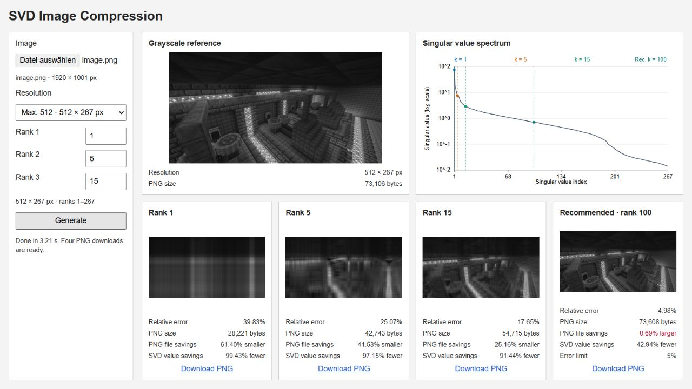

<div align="center">

# SVD Image Compression

**Linear algebra you can see · Lineare Algebra zum Ansehen**

Python · JavaScript · NumPy · Pillow · Pyodide

[English](#english) · [Deutsch](#deutsch)

</div>



## English

An interactive learning project that shows how much image detail can be retained
with fewer singular values. Upload your own image, choose three ranks and compare
their reconstructions with a fourth result recommended by a **5% error target**.

### What you can explore

- **Quality versus rank:** exactly three independently selectable ranks and a
  logarithmic singular-value spectrum.
- **Resolution versus runtime:** 64, 128, 512 or Original, preserving aspect ratio
  without upscaling. Dimensions and rank limits update before calculation.
- **A measured recommendation:** the smallest rank with relative Frobenius error
  at most 5%, verified on the floating-point reconstruction.
- **Four PNG downloads:** actual file sizes compared with the processed grayscale
  reference (**PNG file savings**). A low-rank result can produce a larger PNG;
  increases are shown. **SVD value savings** separately compares the theoretical
  counts `k(height + width + 1)` and `height × width`, assuming equal bytes per
  value and excluding encoding/overhead. It does not measure exported file bytes.
- **Local processing:** selected images stay in browser memory. Calculations are
  cancellable, and changing ranks reuses the cached SVD.

### How it works

The image becomes a grayscale matrix normalized by dividing intensities by 255.0.
The custom direct SVD uses **Householder bidiagonalization** followed by **implicit
shifted QR iteration with Givens rotations**, without a Gram matrix or library
decomposition. Reconstruction keeps the largest singular components:

$$A_k = U_k \Sigma_k V_k^T$$

| Layer | Responsibility |
| --- | --- |
| HTML / CSS | Basic desktop layout |
| JavaScript | File selection, controls, SVG chart and worker messages |
| Python | Image preparation, custom SVD, recommendation and PNG export |
| Pyodide Web Worker | Runs Python locally while keeping the interface responsive |

The interface uses a basic desktop layout without a separate mobile view.
The complete static application is in `docs/`, ready for GitHub Pages without a
backend or build step. On first use, **Pyodide 314.0.8**, NumPy and Pillow load
from jsDelivr, requiring an internet connection. Image data is never sent there.

This is an educational Float64 solver with finite precision and a convergence
limit. The log chart omits numerical zeros; the thin factors retain all values.
The 5% criterion measures matrix error before PNG clipping/rounding, rather than
perceived image quality or minimum file size. Original resolution can be slow.

For a local preview, serve `docs/` over HTTP, for example:

```sh
python -m http.server 8080 --bind 127.0.0.1 --directory docs
```

Open [localhost:8080](http://127.0.0.1:8080). This server only delivers static files;
Python calculations execute in the browser.

## Deutsch

Ein interaktives Lernprojekt, das zeigt, wie viele Bilddetails mit wenigen
Singulärwerten erhalten bleiben. Lade ein eigenes Bild hoch, wähle drei Ränge und
vergleiche ihre Rekonstruktionen mit einer vierten Empfehlung anhand einer
**Fehlergrenze von 5%**.

### Was du untersuchen kannst

- **Bildqualität und Rang:** genau drei unabhängig wählbare Ränge und ein
  logarithmisches Singulärwertspektrum.
- **Auflösung und Laufzeit:** 64, 128, 512 oder Original, mit unverändertem
  Seitenverhältnis und ohne Hochskalieren. Bildmaße und Ranggrenzen werden vor
  der Berechnung angepasst.
- **Eine gemessene Empfehlung:** der kleinste Rang mit höchstens 5% relativem
  Frobeniusfehler, anhand der Gleitkomma-Rekonstruktion überprüft.
- **Vier PNG-Downloads:** tatsächliche Dateigrößen im Vergleich zum verarbeiteten
  Graustufenbild (**PNG file savings**). Ein niedriger Rang garantiert keine
  kleinere PNG-Datei; Vergrößerungen werden ebenfalls angezeigt.
  **SVD value savings** vergleicht separat die theoretische Anzahl gespeicherter
  Zahlen: `k(Höhe + Breite + 1)` gegenüber `Höhe × Breite`. Dabei wird gleicher
  Speicherbedarf je Zahl angenommen; Kodierung und Verwaltungsdaten bleiben
  unberücksichtigt. Das ist keine Messung der exportierten Dateigröße.
- **Lokale Verarbeitung:** ausgewählte Bilder bleiben im Arbeitsspeicher des
  Browsers. Berechnungen sind abbrechbar; Rangänderungen verwenden die vorhandene
  SVD erneut.

### So funktioniert es

Das Bild wird in eine Graustufenmatrix umgewandelt und durch Division durch 255.0
auf feste Intensitätsgrenzen von 0 bis 1 normiert. Die selbst implementierte direkte
SVD nutzt **Householder-Transformationen zur Bidiagonalisierung** und anschließend
**implizite QR-Iteration mit Shift und Givens-Rotationen**. Es wird weder eine
Gram-Matrix gebildet noch eine fertige Zerlegungsroutine aufgerufen. Die
Rekonstruktion behält die größten Singulärwerte und ihre zugehörigen Vektoren.

JavaScript steuert die Oberfläche, Dateiauswahl und Worker-Kommunikation; Python
übernimmt Bildverarbeitung, SVD, Rangempfehlung und PNG-Export. **Pyodide führt
Python direkt im Browser aus.** Die statische Webseite liegt vollständig in
`docs/` und benötigt weder Backend noch Build-Schritt.

Beim ersten Gebrauch werden Pyodide, NumPy und Pillow von jsDelivr geladen;
dafür ist eine Internetverbindung erforderlich. Die ausgewählten Bilddaten
werden nicht übertragen. Die Oberfläche ist auf Englisch und verwendet ein einfaches Desktop-Layout
ohne separate Mobilansicht.

Die Berechnung verwendet Float64 mit begrenzter Genauigkeit und einer
Iterationsgrenze. Numerische Nullwerte werden im Log-Spektrum ausgeblendet,
bleiben aber in den vollständigen dünnen Faktoren enthalten. Die 5%-Grenze
bezieht sich auf den Matrixfehler vor dem Begrenzen und Runden für den PNG-Export,
nicht auf die subjektive Bildqualität oder die kleinste Dateigröße.
Originalauflösung kann entsprechend lange dauern.

Für eine lokale Vorschau eignet sich der oben angegebene HTTP-Server-Befehl.
Er liefert lediglich statische Dateien aus; die Berechnung läuft im Browser.

## Project structure / Projektstruktur

```text
docs/
  index.html, style.css       Page and desktop layout
  main.js                    UI, resource limits and worker coordination
  svd-worker.js              Pyodide initialization and transport
  spectrum.js                Logarithmic SVG chart
  python/svd.py              Direct SVD, reconstruction and rank selection
  python/image_pipeline.py   Image preparation, caching and PNG encoding
  .nojekyll
screenshots/                 README images only; not used by the application
```

## Sources and notices / Quellen und Hinweise

The [lecture script / Vorlesungsskript](https://fabian-s.github.io/fmm-skript/skript/)
supplies SVD, Eckart–Young, Householder, Givens and QR foundations. The complete
bidiagonal SVD is an additional implementation. Its QR cases, zero chasing and
shift are adapted from the [public-domain JAMA/LINPACK reference](https://math.nist.gov/javanumerics/jama/),
developed jointly by The MathWorks and NIST. Neither organization assumes
responsibility for third-party use or guarantees quality, reliability or other
characteristics. The application does not import JAMA.

Das Vorlesungsskript liefert die mathematischen Grundlagen. Die vollständige
bidiagonale SVD ist eine weiterführende Implementierung; die QR-Fallunterscheidungen
orientieren sich an der gemeinfreien JAMA/LINPACK-Referenz. JAMA wird nicht als
Bibliothek verwendet. The MathWorks und NIST übernehmen keine Verantwortung oder
Gewährleistung für die Nutzung ihrer Referenzimplementierung.

Runtime/package licenses / Lizenzen der Laufzeit und Pakete:
[Pyodide](https://github.com/pyodide/pyodide/blob/314.0.8/LICENSE) ·
[NumPy](https://numpy.org/doc/stable/license.html) ·
[Pillow](https://pillow.readthedocs.io/en/stable/about.html#license).

Inspired by / Inspiriert von der
[truncated SVD Shiny demonstration](https://fabian-s.shinyapps.io/truncatedSVD-shiny/).
The screenshot depicts Minecraft (Mojang/Microsoft); this project is not affiliated
with them. No blanket asset license is asserted and no project source-code license
has been selected.

Der Screenshot zeigt Minecraft (Mojang/Microsoft). Es besteht keine Verbindung
zu diesen Unternehmen. Eine pauschale Lizenz für fremde Bildinhalte wird nicht
beansprucht; eine Lizenz für den eigenen Projektquellcode wurde noch nicht gewählt.
